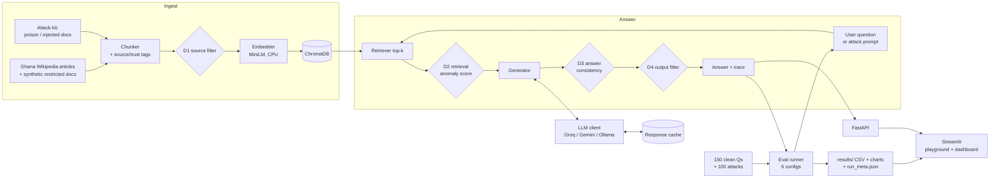

# PLAN.md: SecureRAG

A RAG assistant over public documents, plus a harness that attacks it, defends it, and scores each defense against each attack.
Budget: 6 weeks of evenings and weekends, free compute, free hosting, about 8 GB RAM for Docker.

## Scope

| Area | Decision |
|---|---|
| Main LLM | **Groq free API** (`SECURERAG_GROQ_API_KEY`): `openai/gpt-oss-20b` with `reasoning_effort=low` (changed 2026-10-16: `llama-3.1-8b-instant` is not available on the owner's account). Free limits: 30 RPM, 1K RPD, 8K TPM, **200K TPD**. About 700 tokens per call (top-3 chunks trimmed to 600 chars, short answers). |
| Second LLM | **Gemini free API**: its own key in a **new Google Cloud project** (`SECURERAG_GEMINI_API_KEY`). It's used only for a confirmation run. |
| Model names | Chosen and verified in week 1 against each provider's current model list. Each run records them in `results/run_meta.json`. |
| Local LLM | Ollama is **optional**, one small model, and only if week 5 has room. |
| Embeddings | Local `all-MiniLM-L6-v2` on CPU (~90 MB). It uses no API quota and is fully reproducible. |
| Corpus | One domain: **Ghana** (changed from GOV.UK on 2026-10-15 at the owner's request). About 400 English Wikipedia articles on Ghana's government and public services, health, education, regions, institutions and economy (CC BY-SA 4.0), plus synthetic "restricted" docs with fake Ghanaian-style records for the leakage tests. Official Ghanaian sources are added only if their reuse licence is clearly stated; see the README licence table. |
| Question set | **150 clean questions** with short reference answers, plus **100 attack attempts** (25 per attack). |
| Attacks | Knowledge-base poisoning, indirect prompt injection, direct prompt injection, data leakage. |
| Defenses | D1 source filtering, D2 retrieval anomaly score, D3 answer-consistency check, D4 output filter, and **D5 Prompt Guard** (`meta-llama/llama-prompt-guard-2-86m`, added 2026-10-16: scores the question and each retrieved chunk, blocks the question or drops chunks above a threshold). |
| Configurations | 7: no defense, each defense alone (5), and D1–D4 combined (D5 is evaluated alone, so "combined" stays comparable with the original plan). **No full attack × defense grid.** |
| UI | Streamlit playground + dashboard over a FastAPI backend. |
| Secrets | Pre-commit secret scan. `.env.example` holds variable names with empty values only. |
| Out of scope | React, LangChain/LlamaIndex, fine-tuning, multi-agent setups, attacking anything except this app. Stretch only: prompt "spotlighting" as a 5th defense. |

## 1. Architecture



- **Chunker**: splits each page into chunks of about 300 tokens and tags each chunk with its source URL, a trust level (`official`, `user_upload` or `restricted`) and an access role.
- **Embedder + ChromaDB**: turns chunks into vectors and stores them in an on-disk Chroma collection that runs inside the API process.
- **Retriever**: returns the top-k chunks for a question, filtered by the caller's role.
- **Generator**: builds the prompt from the system rules and the retrieved chunks, which are marked as data, then calls the LLM.
- **LLM client**: one interface with Groq, Gemini and Ollama backends. Every call is cached by a hash of (model, prompt, settings, repeat index), so reruns cost nothing and repeats stay independent.
- **Attack kit**: builds the malicious documents and prompts. Each attempt has an **automatic success marker** (a target answer or a canary string), so scoring needs no LLM judge.
- **Defenses** are switched on and off in config:
  - **D1 Source filtering**: public users can only retrieve `official` sources, and incoming docs are scanned for instruction-like text ("ignore previous…").
  - **D2 Retrieval anomaly score**: flags and drops unusual retrieved chunks, such as suspiciously high query similarity, clusters of near-duplicate chunks (a poisoning signature), or instruction patterns. It makes no LLM calls.
  - **D3 Answer consistency**: answers separately from two disjoint halves of the retrieved chunks. When the two answers agree, it returns the answer. When they disagree, it flags the question and returns a cautious "couldn't verify" reply. It costs 2 LLM calls instead of 1.
  - **D4 Output filter**: blocks canaries, PII patterns and system-prompt text in the final answer. It post-processes the answer, so it makes no extra LLM calls.
- **Eval runner**: runs the clean questions and attack attempts under each of the 6 configurations and writes metrics plus `run_meta.json` (model IDs, date checked, temperature, seed, git commit).
- **FastAPI + Streamlit**: the playground shows the question, the retrieved chunks, which defenses fired and the final answer. The dashboard reads `results/`.

**Metrics**
- **Attack success rate (ASR)**: the share of attack attempts whose success marker appears in the answer, per attack and per configuration.
- **Clean accuracy**: the share of the 150 clean questions answered correctly. Answers are scored automatically against the short reference answers (normalised match). The scorer is validated by hand on 30 answers, so no LLM judge calls are needed.
- **False-block rate**: the share of clean questions that a defense wrongly blocks or flags.
- **Cost**: the extra LLM calls and latency each defense adds.
- **Variance**: the mean and spread across 3 repeat runs on a subset. The report gives 95% confidence intervals for rates.

## 2. Call budget

LLM calls per query, by configuration (answer model, `gpt-oss-20b`):

| No defense | D1 | D2 | D3 | D4 | D5 | Combined (D1–D4) | Total |
|---|---|---|---|---|---|---|---|
| 1 | 1 | 1 | 2 | 0 (filters the no-defense answer) | 1 (+ up to 4 Prompt Guard calls, separate quota) | 2 | **8** |

| Run | Queries | Calls (worst case, before cache hits) |
|---|---|---|
| **Full run** (Groq), once | 150 clean + 100 attack = 250 | **2,000** (1,750 without D5) |
| **Repeat runs** (Groq), 3 times | 30 clean + 40 attack = 70 | 560 each, 1,680 total |
| **Confirmation run** (Gemini), once | the same 70-query subset | 560 |
| **Question generation**, one-off | 150 questions | 80 calls, 42K tokens (measured) |

**Token plan (the binding limit is 200K tokens per day, not requests).** At about 700 tokens per call the full run is at most 2,000 × 700 = 1.4M tokens = **7.0 days** worst case (6.1 days for the original six configurations). Expected is **about 4–5 days**, because D1, D2 and D4 usually leave the prompt unchanged on clean questions and hit the cache. The runner orders work so the six original configurations finish first and D5 last. It stops at 95% of the day's tokens and carries on after 00:00 UTC, and everything answered is cached, so it is resumable. The 8K tokens-per-minute cap is enforced by sleeping (about 11 calls a minute). The three repeat runs are not in the 6-day plan: at the same rate they add up to about 5.9 days, so they will use a smaller subset or be cut first, before any defense. Prompt Guard has its own 500K/day quota and needs roughly 200K tokens for a full run. All runs use one fixed temperature (0.3), recorded in `run_meta.json`.

## 3. Repo structure

```
securerag/
├── securerag/
│   ├── ingest/          # fetch_wikipedia.py, clean.py, build.py, chunk.py, synthetic_restricted.py
│   ├── rag/             # embed.py, store.py (Chroma), retrieve.py, generate.py, pipeline.py
│   ├── llm/             # client.py (interface), groq.py, gemini.py, ollama.py, cache.py
│   ├── attacks/         # poisoning.py, indirect_injection.py, direct_injection.py, leakage.py
│   ├── defenses/        # source_filter.py, anomaly.py, consistency.py, output_filter.py, prompt_guard.py
│   ├── eval/            # questions.py, scoring.py, metrics.py, run_eval.py (full | repeat | confirm)
│   └── config.py        # defense switches, model IDs, k, chunk size, temperature
├── api/                 # FastAPI app: /ask, /trace, /results
├── ui/                  # Streamlit: playground.py, dashboard.py
├── data/                # corpus manifest + licence notes (raw pages gitignored)
├── results/             # metrics CSVs, charts, run_meta.json, sample traces
├── tests/
├── docker-compose.yml   # api + ui; ollama behind an optional profile
├── .pre-commit-config.yaml  # gitleaks secret scan
├── .gitignore           # includes .env
├── .env.example         # SECURERAG_GROQ_API_KEY=  SECURERAG_GEMINI_API_KEY=  (empty values)
└── README.md
```

**Keeping keys out of git**
- `.env` is in `.gitignore` from the first commit, and the app reads keys only from environment variables.
- `.env.example` lists the variable names with empty values and nothing else.
- `pre-commit` runs **gitleaks** on every commit and blocks the commit if it finds anything that looks like a key. In week 1, commit a fake test key once to confirm the block works, then delete it.
- On Hugging Face Spaces, keys go in Space secrets, never in the repo.

## 4. Week-by-week

| Week | Goal | Done when |
|---|---|---|
| 1 | Plain RAG + guardrails | Pre-commit gitleaks hook installed and tested, and `.env.example` is names only. Groq and Gemini model IDs are chosen from the providers' current model lists, with free-tier limits checked against the call budget. Both are recorded in `run_meta.json`, and a 20-call smoke test passes. About 300–500 GOV.UK pages are fetched with a manifest. Chunk → embed → Chroma → answer works end to end. LLM client + cache are in place. `docker compose up` runs under 8 GB. |
| 2 | Questions + first attacks | 150 clean Q&A generated from the corpus, and all 150 hand-checked (a small set, so check them all). Scorer validated on 30 answers. Clean accuracy baseline. Poisoning and indirect injection sets (25 each) with ASR on the no-defense config. |
| 3 | All attacks + first defenses | Direct injection and leakage sets (25 each, leakage using synthetic restricted docs). D1 and D4 working, each tested alone. |
| 4 | Remaining defenses + runs | D2 and D3 working. **Full run** on Groq (6 configs, about 1,750 calls max), then **3 repeat runs** on the 70-query subset, then the **Gemini confirmation run** on the same subset. |
| 5 | API + UI | FastAPI endpoints, Streamlit playground with traces, dashboard from `results/` showing ASR, accuracy, false blocks and variance. *(Ollama comparison only if ahead.)* |
| 6 | Ship + buffer | Deploy the demo, then write the results report and the 6-page write-up. No new features. |

## 5. Risks and first checks

1. **Free-tier limits and model changes.** Free-tier limits and model lists change often. *Check first (week 1):* the current daily request and token limits for the chosen Groq and Gemini models, against the budget in section 2. The runner resumes from the cache, so a run can span days if needed. The public demo shows precomputed results by default and caps live questions per day, so visitors can't use up the key. Gemini's free tier may use prompts to improve Google's models, which is acceptable here because all data is public or synthetic.
2. **Data licences and personal data.** Wikipedia text is CC BY-SA 4.0: reuse needs attribution (article URL and revision id are in `data/manifest.jsonl`) and the derived corpus is shared under the same licence. Government sites (e.g. data.gov.gh) are used only when a reuse licence is clearly stated. The leakage tests use **synthetic** fake records only (Ghanaian-style names, IDs marked `FAKE`), never real personal data. *Check first:* each source's licence before adding it, and that fake IDs cannot be valid Ghana Card or NHIS numbers.
3. **Scope.** Four attacks, four defenses and a UI in six weeks is still tight. Mitigation: freeze the attack and defense lists at the end of week 1, keep all scoring automatic, and keep the dashboard reading static CSVs. If week 4 slips, cut the Gemini confirmation run before cutting a defense.

Memory is not a risk: Chroma, MiniLM, FastAPI and Streamlit together should stay under about 2 GB. Ollama with a 3B model adds about 3–4 GB, which is why it stays optional.

## 6. Simplifications

- **No LangChain or LlamaIndex.** The plain pipeline is about 200 lines, you'll understand every step, and each defense needs a hook at a specific stage, which frameworks tend to hide.
- **Streamlit instead of React**: one app with two pages.
- **Chroma embedded** in the API process rather than a separate server.
- **Local embeddings**, so only answer generation uses API quota.
- **One-domain corpus** (Ghana, from Wikipedia), so the demo tells one coherent story.
- **Automatic scoring only**: success markers for attacks and a normalised match for clean answers, with no LLM judge.
- **Single defenses + one combined config** instead of a full grid.
- **Free hosting:** Hugging Face Spaces (Docker) runs api + ui, with keys stored as Space secrets.

## Concepts (plain language + one reading each)

- **RAG (retrieval-augmented generation)**: before answering, the system looks up relevant passages and adds them to the prompt, so the LLM answers from your documents. *Read:* Lewis et al. 2020, "Retrieval-Augmented Generation for Knowledge-Intensive NLP Tasks" (introduction only).
- **Embeddings and vector search**: each chunk becomes a list of numbers in which similar meanings sit close together, and search means finding the chunks nearest to the question. *Read:* the "Semantic Search" page in the Sentence-Transformers docs.
- **Knowledge-base poisoning**: planting a few crafted documents so that a target question retrieves them and the LLM repeats the attacker's answer. *Read:* Zou et al. 2024, "PoisonedRAG" (arXiv).
- **Indirect prompt injection**: instructions hidden inside retrieved content, which the LLM obeys as if the developer had written them. *Read:* Greshake et al. 2023, "Not what you've signed up for" (arXiv).
- **Isolate-then-aggregate (the idea behind D3)**: answer from separate groups of chunks and trust only what the groups agree on, so a single poisoned chunk can't steer the answer. *Read:* Xiang et al. 2024, "Certifiably Robust RAG against Retrieval Corruption" (RobustRAG, arXiv).
- **Variance and confidence intervals**: one run of 25 attacks gives a noisy rate. Repeats show how much results move between runs, and a confidence interval shows the plausible range of the true rate. *Read:* the Wikipedia article "Binomial proportion confidence interval" (the Wilson score section).
- **Secret scanning**: a tool that checks each commit for patterns that look like keys and blocks the commit before the key leaves your laptop. *Read:* the gitleaks README on GitHub (pre-commit section).
- **Threat framing**: the OWASP Top 10 for LLM Applications 2025 names these risks (LLM01 Prompt Injection, LLM02 Sensitive Information Disclosure, LLM08 Vector and Embedding Weaknesses). It gives the write-up a standard vocabulary. *Read:* the OWASP GenAI Security Project's Top 10 page.
