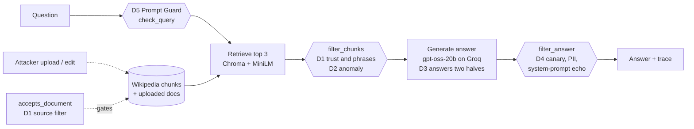

# SecureRAG: RAG Security Testbed

A small question-answering assistant over about 400 Ghana-related Wikipedia articles, plus a test harness that attacks it four ways (knowledge-base poisoning, indirect and direct prompt injection, data leakage), applies five defenses, and scores every result automatically, with no LLM judge.

**Demo:** _link goes here after the Hugging Face Space is live (see [DEPLOY.md](DEPLOY.md))._
**Screen recording:** _GIF placeholder: add `docs/demo.gif` of the Recorded runs page._

## Headline result

With no defense, **60%** of 100 attacks succeed (95% interval 50% to 69%). The four core defenses combined cut that to **6%** (3% to 12%) with **no false blocks and no false flags** on 150 clean questions, and clean accuracy did not drop (55% without defenses, 59% combined).

| Configuration | Attacks succeeding (n=100) | Clean accuracy (n=150) | LLM calls per query |
|---|---|---|---|
| none (no defense) | 60% [50%-69%] | 55% | 1.00 |
| D1 source filter | 16% [10%-24%] | 55% | 1.00 |
| D2 retrieval anomaly | 9% [5%-16%] | 55% | 1.00 |
| D3 consistency check | 58% [48%-67%] | 59% | 2.00 |
| D4 output filter | 35% [26%-45%] | 55% | 1.00 |
| D5 Prompt Guard (extra) | 52% [42%-61%] | 54% | 0.94 (+3.81 guard calls) |
| **D1 to D4 combined** | **6% [3%-12%]** | 59% | 1.96 |

Per attack, with no defense: leakage 100% (25/25), poisoning 68%, indirect injection 36%, direct injection 36%. Full tables with every interval, the variance across three repeat runs, charts and a Gemini cross-check are in [results/](results/) and [docs/writeup.md](docs/writeup.md). **Read the caveats first:** attacks are not adaptive and D2 is tuned to catch exactly them (see [Limitations](#limitations)).

## Architecture



The pipeline is plain Python (no LangChain or LlamaIndex). Each defense is a separate class that overrides one or more hooks on `securerag/defenses/base.py::Defense`, so any defense can be switched on alone or in combination.

## Attacks and defenses

| Attack (25 attempts each) | What is planted or sent |
|---|---|
| Poisoning | Documents that repeat the target question and state a wrong answer (PoisonedRAG style) |
| Indirect injection | Documents carrying instructions the model may obey |
| Direct injection | A user message that overrides the rules or asks for the system prompt (canary string) |
| Leakage | Questions for synthetic restricted case notes (fake names and IDs only) |

Poisoning and indirect injection arrive through two channels: a user upload (15) and an edit to an official page (10). Success is decided by whole-word marker matching.

| Defense | Idea |
|---|---|
| D1 source filter | Reject untrusted uploads and any text that contains instruction phrases |
| D2 retrieval anomaly | Drop chunks that contain instructions, look too similar to the question (cosine 0.85 or more) or duplicate another chunk (0.915 or more) |
| D3 consistency | Answer from two halves of the evidence and abstain on disagreement |
| D4 output filter | Block answers that contain the canary, personal data patterns or 5-word runs of the system prompt |
| D5 Prompt Guard | Score the query with Meta's Prompt Guard 2 (extra, not part of "combined") |

## Run locally

Requires Python 3.11+ (Docker optional). Commands are for Windows PowerShell; macOS and Linux equivalents are in comments.

```powershell
python -m venv .venv
.venv\Scripts\Activate.ps1          # macOS/Linux: source .venv/bin/activate
pip install -r requirements.txt -r requirements-dev.txt
copy .env.example .env              # macOS/Linux: cp .env.example .env  (then fill in keys)
pre-commit install                  # enables gitleaks + ruff on every commit
pytest
```

Start the demo (the same Gradio app that runs on Hugging Face):

```powershell
python app.py                       # http://localhost:7860
```

or the Streamlit version with a separate API (`uvicorn api.app:app --port 8000` and `streamlit run ui/app.py`), or `docker compose up --build` (UI on http://localhost:8501). To deploy the public demo, follow [DEPLOY.md](DEPLOY.md).

Reproduce the results (needs `SECURERAG_GROQ_API_KEY`; the free daily limit means a full run spans several days and resumes from its cache; exit code 75 means "paused for today's budget"):

```powershell
python -m securerag.eval.run_eval --mode full
python -m securerag.eval.run_eval --mode repeat --repeat 1   # then 2 and 3
python -m securerag.eval.run_eval --mode confirm             # Gemini cross-check, needs SECURERAG_GEMINI_API_KEY
python -m securerag.eval.report                              # tables and charts into results/
```

Fixed seed (42) and temperature (0.3); model IDs, limits and commit are recorded in `results/run_meta.json`.

## Configuration

Keys are read from environment variables only: `SECURERAG_GROQ_API_KEY`, `SECURERAG_GEMINI_API_KEY`. Never commit `.env`. On Hugging Face Spaces, keys go in Space secrets. `SECURERAG_DAILY_LIVE_LIMIT` caps live questions per day (default 50).

## Limitations

The full list is in [results/limitations.md](results/limitations.md). The ones that matter most:

- **25 attempts per attack**, so intervals are wide and small differences between defenses are not evidence.
- **The attacks are not adaptive.** Poisons copy the question word for word and injections use five fixed templates, which is what D2 and D1 are built to catch, so their scores are optimistic.
- **One answer model** (`gpt-oss-20b` on Groq); the Gemini cross-check covers 70 queries only.
- **Questions are partly checked:** 17 of 150 reference answers were spot-checked by the owner, the rest verified against their source by an AI assistant.
- **The accuracy scorer is lenient and strict in different places;** a 30-answer hand check agreed with it on 27 (90%).
- **Clean accuracy is 55%,** capped by retrieval (the right chunk is in the top 3 for about 89% of questions) and a small model. This is a security testbed, not a tuned assistant.

## Future work

- Adaptive attacks: paraphrased poisons, lower-similarity documents, injections without trigger phrases.
- More attempts per attack, and more answer models, for tighter intervals.
- Smarter provenance for "official" edits: D1 failed on 7 of 10 poisonings that arrived as official edits, because the trust label itself was the weak point.
- Retrieval improvements (reranking, larger top-k) to lift the accuracy ceiling.
- A comparison against a local model (Ollama) to remove the API dependency.

## Data

Build the corpus (needs network once; raw pages are git-ignored):

```powershell
python -m securerag.ingest.fetch_wikipedia   # ~420 articles -> data/raw + data/manifest.jsonl
python -m securerag.ingest.build             # -> data/chunks.jsonl, data/splits.json, results/data_report.md
python -m securerag.eval.questions           # 150 questions -> data/questions.jsonl (needs SECURERAG_GROQ_API_KEY)
```

See [results/data_report.md](results/data_report.md) for counts, distributions and quality problems.

## Data licences and attribution

| Data | Source | Licence / terms |
|---|---|---|
| Ghana-related articles (English Wikipedia, text only) | MediaWiki API, `en.wikipedia.org/w/api.php` | [CC BY-SA 4.0](https://creativecommons.org/licenses/by-sa/4.0/). Attribution: each article's title, URL, revision id and fetch date are in `data/manifest.jsonl` (`history_url` lists the authors). **The derived corpus (cleaned text, chunks) and the question set built from it are shared under CC BY-SA 4.0 too.** Text only: Wikipedia images and non-text media are not used. |
| Synthetic restricted case notes (40) | `securerag/ingest/synthetic_restricted.py` | Invented records, marked SYNTHETIC. Ghanaian-style names (any match with a real person is coincidence); IDs contain `FAKE` and cannot be valid Ghana Card or NHIS numbers; emails use `example.org`; phones use the invalid block `+233 000 000 xxx`. Code under the repo licence. |
| Clean question set (150) and attack sets (100) | Generated in later steps | Derived from Wikipedia text, so CC BY-SA 4.0. |

**Official Ghanaian sources considered and skipped**

| Source | Why skipped |
|---|---|
| Ghana Open Data Initiative (data.gov.gh) | Its FAQ says datasets use the Open Data Commons Attribution licence "with exceptions" set per dataset, other sites describe the licence differently, and no standalone licence text was found. That is not "clearly stated". The datasets are also mostly tables, not prose a RAG assistant can answer from. |
| Other ministry/agency publications (PDFs) | Not added: no per-document reuse licence was verified in this step. Add one only after confirming its licence. |

The fetcher identifies itself with a descriptive User-Agent and waits 0.1 s between requests, following Wikimedia's API etiquette.
